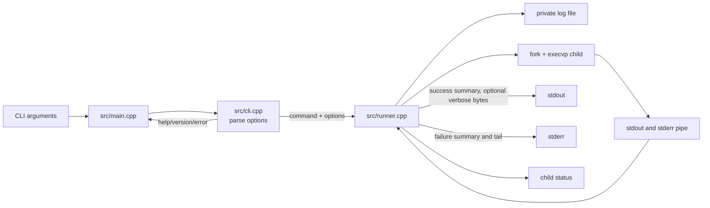

# Architecture

Muffle has a small parser, a process runner, and a thin executable entry
point. The runner uses a pipe and a file rather than keeping all output in
memory.

## Source responsibilities

- `src/main.cpp` converts `argv` to strings, dispatches parser actions, and
  returns the runner status.
- `src/cli.cpp` implements the option parser and help text.
- `src/runner.cpp` creates the log and pipe, constructs the child `argv`,
  calls `fork` and `execvp`, captures output, forwards SIGINT/SIGTERM,
  waits, prints a summary, and translates signal termination to a status.
- `include/muffle/cli.hpp` exposes parsed options and parser actions.
- `include/muffle/runner.hpp` exposes the command runner interface.

The child stdout and stderr descriptors are both redirected to the same
pipe. The parent copies data to the log and optionally to its stdout. On
failure, it scans the log backward to locate the requested tail, then writes
the tail to stderr. The return value is the child's exit status, a
signal-derived status, or one of Muffle's reserved errors.

See [process execution](process-execution.md), [logging](logging.md), and
[signal handling](signal-handling.md) for operational details.
